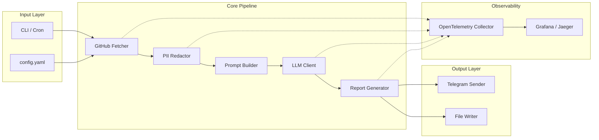
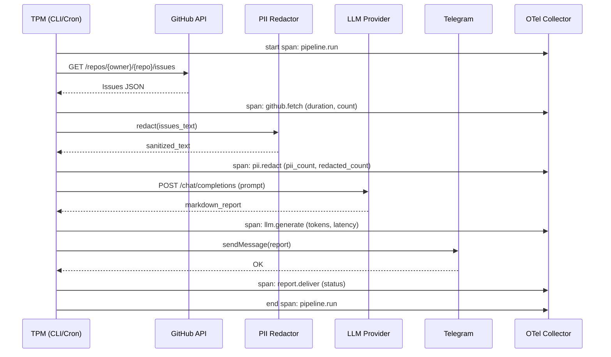

## Context
Проект `ai-tpm-copilot` представляет собой сервис автоматизации отчетности для TPM, который агрегирует данные из GitHub, очищает их от PII, анализирует через LLM и доставляет результат стейкхолдерам.

Ключевые ограничения: Python 3.11+, соответствие 152-ФЗ (запрет на передачу PII в LLM без очистки), необходимость сквозной наблюдаемости (OpenTelemetry) и работа с российскими LLM-провайдерами (GigaChat/YandexGPT) в условиях импортозамещения.

## Goals / Non-Goals

**Goals:**
- Автоматизировать сбор данных из GitHub Issues/PR за заданный период.
- Обеспечить 100% очистку PII перед отправкой в LLM.
- Генерировать Markdown-отчет с категоризацией (Выполнено, В работе, Заблокировано, Риски).
- Инструментировать пайплайн через OpenTelemetry (трейсы, метрики, логи).
- Обеспечить доставку отчета в Telegram или файл.

**Non-Goals:**
- Замена Jira/Linear (работаем только с GitHub).
- Полноценный UI-дашборд (только CLI + Telegram).
- Автоматическое создание Issues на основе анализа (только рекомендации).
- Поддержка множественных LLM-провайдеров одновременно.

## Decisions

### Компонентная архитектура

**Слои:**
1. **Input Layer:** CLI-интерфейс (typer) и конфигурация (pydantic-settings из `.env` + `config.yaml`).
2. **Core Pipeline:** `GitHubFetcher`, `PIIRedactor`, `PromptBuilder`, `LLMClient`, `ReportGenerator`.
3. **Output Layer:** `TelegramSender` и `FileWriter` (fallback).
4. **Observability:** OTel SDK → OTel Collector → Jaeger + Prometheus.

### Потоки данных

**Ключевые решения:**
- PII-очистка происходит **до** формирования промпта — LLM никогда не видит сырые данные.
- Retry на уровне `GitHubFetcher` и `LLMClient` (tenacity).
- Fallback: если Telegram недоступен → запись в файл.

### Технологический стек

| Слой | Технология | Обоснование |
|---|---|---|
| Язык | Python 3.11+ | Совместимость с ai-tax-assistant |
| CLI | Typer | Простота, типизация |
| Конфиг | pydantic-settings + python-dotenv | Валидация ENV, безопасность |
| GitHub API | httpx + PyGithub | Async, retry через tenacity |
| PII Redaction | presidio-analyzer + кастомные regex | Покрытие 152-ФЗ |
| LLM Client | GigaChat SDK / YandexGPT API | Импортозамещение |
| Telegram | aiogram 3.x | Async, надежность |
| Observability | opentelemetry-sdk + OTLP exporter | Совместимость со стеком |
| Тесты | pytest + pytest-asyncio + respx | Стандарт |
| CI/CD | GitHub Actions | Интеграция с репозиторием |

## Risks / Trade-offs

- **Риск**: LLM галлюцинирует статусы. → **Митигация**: fact-check по Issue ID (ADR-003).
- **Риск**: Presidio не покрывает СНИЛС/ИНН. → **Митигация**: кастомные regex (ADR-001).
- **Риск**: Prompt Injection. → **Митигация**: XML-изоляция (ADR-002).
- **Риск**: Превышение лимита токенов. → **Митигация**: truncation + tiktoken.
- **Trade-off**: Отказ от UI в пользу CLI+Telegram.
- **Trade-off**: Один LLM-провайдер на конфиг (fallback позже).

## Migration Plan
1. **Фаза 1 (MVP):** CLI + GitHub Fetcher + PII Redactor + GigaChat + File Writer.
2. **Фаза 2:** Telegram + OpenTelemetry.
3. **Фаза 3:** Cron + Grafana.
4. **Фаза 4:** YandexGPT как альтернатива.

## Open Questions
- [ ] Какой LLM-провайдер по умолчанию: GigaChat или YandexGPT?
- [ ] Поддержка нескольких репозиториев в одном запуске?
- [ ] Формат Telegram-сообщения: единое длинное или несколько коротких?
- [ ] Интеграция с GitHub Projects (v2)?