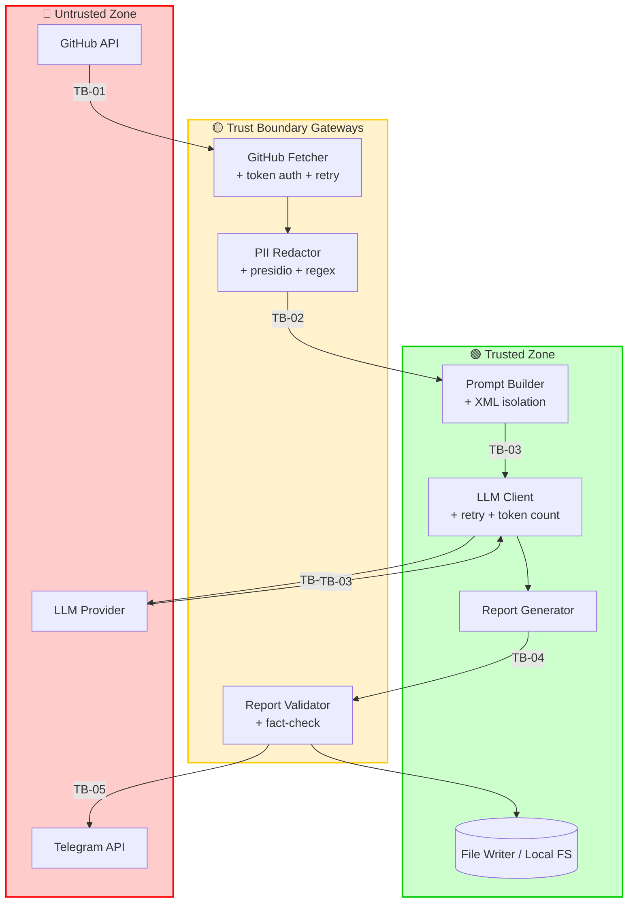

## 1. Выбор методологии
- **Выбрано:** STRIDE + OWASP Top 10 for LLM (комбинированно)
- **Обоснование:** security_context содержит `ai: ["LLM", "RAG", "Summarization"]`, `assets: ["PII", "Internal Project Data"]`, `regulatory: ["152-ФЗ"]`. Правило выбора №1 промпта предписывает комбинацию для гибридных систем с PII и регуляторикой.
- **Отвергнутые альтернативы:**
  - LINDDUN — покрывает только приватность, не покрывает LLM-угрозы.
  - OWASP LLM (только) — не покрывает классические инфраструктурные угрозы.
  - PASTA — избыточна для скоупа MVP.
- **Скоуп:** GitHub Fetcher → PII Redactor → Prompt Builder → LLM Client → Report Generator → Telegram Sender.

## 2. Активы и классификация данных
| Актив | Класс данных | Компонент | Владелец |
|---|---|---|---|
| Issue body / comments | PII (возможны) | GitHub Fetcher → PII Redactor | TPM |
| GitHub token | secret | GitHub Fetcher | infra-team |
| LLM API key (GigaChat) | secret | LLM Client | infra-team |
| Telegram bot token | secret | Telegram Sender | infra-team |
| Sanitized prompt | internal | Prompt Builder → LLM Client | TPM |
| LLM response (report) | internal | LLM Client → Report Generator | TPM |
| Отчет (Markdown) | internal | File Writer / Telegram | TPM |

## 3. Границы доверия (Trust Boundaries)
| ID | Граница | Откуда → Куда | Контроль безопасности |
|----|---------|---------------|----------------------|
| TB-01 | GitHub API → Fetcher | untrusted → trusted | HTTPS + token auth + rate-limit |
| TB-02 | Raw Issues → PII Redactor | untrusted → trusted | regex + presidio + allowlist |
| TB-03 | Prompt Builder → LLM Provider | trusted → untrusted | XML-изоляция + system prompt hardening |
| TB-04 | LLM Response → Report Generator | untrusted → trusted | JSON Schema validation + fact-check |
| TB-05 | Report → Telegram | trusted → untrusted | HTTPS + bot token |
| TB-06 | Config/ENV → Runtime | untrusted → trusted | secret manager + .env не в git |

## 4. Визуализация потоков данных (цветовая кодировка)
**Легенда:**
- 🟢 **Trusted** — компоненты под нашим контролем
- 🔴 **Untrusted** — внешние источники ввода
- 🟡 **Boundary / Gateway** — точки пересечения границ

## 5. Матрица угроз

| ID | Категория | Угроза | Вектор | Актив | TB | Уровень | Контроль | Requirement |
|----|-----------|--------|--------|-------|----|--------|----------|-------------|
| TM-01 | LLM01 / S | Prompt Injection через комментарий Issue | crafted comment | Prompt | TB-03 | High | XML-изоляция + system prompt hardening | NFR-SEC-002 |
| TM-02 | LLM02 / I | Утечка PII в LLM-провайдера | Issue body с email/СНИЛС | PII | TB-02 | High | presidio + кастомные regex | NFR-SEC-001 |
| TM-03 | LLM06 / E | Excessive Agency: LLM галлюцинирует статусы | LLM output | Report | TB-04 | High | JSON Schema + fact-check | NFR-SEC-004 |
| TM-04 | LLM10 / T | Improper Output Handling: инъекция Markdown/HTML в Telegram | LLM output | Telegram | TB-04 | Medium | Markdown escaping + allowlist | NFR-SEC-005 |
| TM-05 | S (Spoofing) | Подмена GitHub API через MITM | network | GitHub token | TB-01 | Medium | HTTPS + certificate pinning | NFR-SEC-006 |
| TM-06 | I (Info Disclosure) | Утечка secrets в git | code commit | Secrets | TB-06 | Critical | .env + secret manager + gitleaks | NFR-SEC-003 |
| TM-07 | D (DoS) | Превышение лимитов GitHub API / LLM quota | rate-limit exhaustion | GitHub API / LLM | TB-01, TB-03 | Medium | retry + backoff + token budget | NFR-002, NFR-003 |
| TM-08 | T (Tampering) | Подмена конфига (config.yaml) | file system | Config | TB-06 | Medium | permissions + checksum + pydantic | NFR-SEC-007 |
| TM-09 | LLM09 (Misinformation) | LLM выдает недостоверный статус | LLM output | Report | TB-04 | High | fact-check по Issue ID | NFR-SEC-004 |

## 6. Требования безопасности (→ в spec.md и design.md)

| Requirement | Описание | Покрывает TM | Метрика / verify |
|-------------|----------|--------------|------------------|
| NFR-SEC-001 | PII-фильтр (presidio + regex для СНИЛС/ИНН) до отправки в LLM | TM-02 | 0 PII в исходящем промпте; тест TC-SEC-001 |
| NFR-SEC-002 | XML-изоляция + system prompt hardening | TM-01 | Инъекция не меняет поведение LLM; тест TC-SEC-002 |
| NFR-SEC-003 | Секреты только в ENV/secret manager; gitleaks в CI | TM-06 | 0 секретов в коммитах; тест TC-SEC-003 |
| NFR-SEC-004 | Fact-check LLM-вывода по Issue ID | TM-03, TM-09 | 100% пунктов отчета имеют Issue ID; тест TC-SEC-004 |
| NFR-SEC-005 | Markdown escaping при отправке в Telegram | TM-04 | 0 HTML-инъекций; тест TC-SEC-005 |
| NFR-SEC-006 | HTTPS + certificate pinning для GitHub API | TM-05 | TLS validation enabled; тест TC-SEC-006 |
| NFR-SEC-007 | Checksum + pydantic-validation конфига | TM-08 | Конфиг валидируется до запуска; тест TC-SEC-007 |

## 7. Влияние на ADR
- **ADR-кандидат:** схема валидации вывода LLM (NFR-SEC-004).
- **ADR-кандидат:** паттерн изоляции промпта (NFR-SEC-002).
- **ADR-кандидат:** стратегия управления секретами (NFR-SEC-003).
- **ADR-кандидат:** выбор PII-redaction библиотеки (NFR-SEC-001).